

<picture>
  <source media="(prefers-color-scheme: light)" srcset="assets/banner-light.svg" />
  
</picture>

 

 

<picture>
  <source media="(prefers-color-scheme: light)" srcset="assets/header-01-light.svg" />
  
</picture>

<picture>
  <source media="(prefers-color-scheme: light)" srcset="assets/dossier-light.svg" />
  
</picture>

 

<picture>
  <source media="(prefers-color-scheme: light)" srcset="assets/header-02-light.svg" />
  
</picture>

<picture>
  <source media="(prefers-color-scheme: light)" srcset="assets/skills-light.svg" />
  
</picture>

 

<picture>
  <source media="(prefers-color-scheme: light)" srcset="assets/header-03-light.svg" />
  
</picture>

click a card — repo if it has one, else the live deploy, else the demo

  

| | | | |
|---|---|---|---|
| [<picture><source media="(prefers-color-scheme: light)" srcset="assets/project-01-light.svg"/></picture>](https://github.com/blacksinisterx/Exploit-Path-Tracer) | [<picture><source media="(prefers-color-scheme: light)" srcset="assets/project-02-light.svg"/></picture>](https://github.com/blacksinisterx/Deposition-Contradiction-Finder) | [<picture><source media="(prefers-color-scheme: light)" srcset="assets/project-03-light.svg"/></picture>](https://drive.google.com/file/d/1ZpO-nzMJUw8zg00oiZCB-ZGMa06_vxou/view) | [<picture><source media="(prefers-color-scheme: light)" srcset="assets/project-04-light.svg"/></picture>](https://github.com/blacksinisterx/Multi-Tenant-Agentic-RAG-System) |
| [<picture><source media="(prefers-color-scheme: light)" srcset="assets/project-05-light.svg"/></picture>](https://github.com/blacksinisterx/CrisSim-Multi-Agent-Simulation) | [<picture><source media="(prefers-color-scheme: light)" srcset="assets/project-06-light.svg"/></picture>](https://github.com/sincera315/Assignment3_Agentic_AI_N8N) | [<picture><source media="(prefers-color-scheme: light)" srcset="assets/project-07-light.svg"/></picture>](https://github.com/blacksinisterx/toolsuite) | [<picture><source media="(prefers-color-scheme: light)" srcset="assets/project-08-light.svg"/></picture>](https://github.com/blacksinisterx/Ai-UX-Auditor) |
| [<picture><source media="(prefers-color-scheme: light)" srcset="assets/project-09-light.svg"/></picture>](https://github.com/blacksinisterx/Ai-Video-Narrator) | [<picture><source media="(prefers-color-scheme: light)" srcset="assets/project-10-light.svg"/></picture>](https://github.com/blacksinisterx/Fact-Checker) | [<picture><source media="(prefers-color-scheme: light)" srcset="assets/project-11-light.svg"/></picture>](https://github.com/blacksinisterx/Clickbait-Decoder) | [<picture><source media="(prefers-color-scheme: light)" srcset="assets/project-12-light.svg"/></picture>](https://github.com/blacksinisterx/Ai-Slop-Blocker) |

 

**ADDITIONAL FIELD WORK**
 
[Story2Audio](https://github.com/blacksinisterx/Story2Audio) · [MPCount](https://github.com/blacksinisterx/Computer-Vision-Project-Inventory-Count) · [Agentic OCR](https://github.com/blacksinisterx/Agentic-OCR) · Flight Delay Prediction (96% accuracy) · [Virtual Painter](https://github.com/blacksinisterx/Virtual-Painter) · [FAQ Chatbot](https://github.com/blacksinisterx/FAQ-Chatbot) · [GANs & VAEs](https://github.com/blacksinisterx/Generative-AI-Assignment-2-GANs-VAEs)

 

<picture>
  <source media="(prefers-color-scheme: light)" srcset="assets/header-04-light.svg" />
  
</picture>

| | | |
|---|---|---|
| [<picture><source media="(prefers-color-scheme: light)" srcset="assets/research-01-light.svg"/></picture>](https://github.com/blacksinisterx/Agentic-AI-Safety-Audit) | [<picture><source media="(prefers-color-scheme: light)" srcset="assets/research-02-light.svg"/></picture>](https://github.com/blacksinisterx/federated-unlearning-multi-attack-evaluation) | [<picture><source media="(prefers-color-scheme: light)" srcset="assets/research-03-light.svg"/></picture>](https://storm-bureau-portfolio.vercel.app/) |
| [<picture><source media="(prefers-color-scheme: light)" srcset="assets/research-04-light.svg"/></picture>](https://storm-bureau-portfolio.vercel.app/) | [<picture><source media="(prefers-color-scheme: light)" srcset="assets/research-05-light.svg"/></picture>](https://github.com/blacksinisterx/Artificial-Neural-Network-Project) | |

 

<picture>
  <source media="(prefers-color-scheme: light)" srcset="assets/header-05-light.svg" />
  
</picture>

<picture>
  <source media="(prefers-color-scheme: light)" srcset="https://raw.githubusercontent.com/blacksinisterx/blacksinisterx/output/streak-light.svg" />
  
</picture>

 

<picture>
  <source media="(prefers-color-scheme: light)" srcset="https://raw.githubusercontent.com/blacksinisterx/blacksinisterx/output/activity-light.svg" />
  
</picture>

  

<picture>
  <source media="(prefers-color-scheme: dark)" srcset="https://raw.githubusercontent.com/blacksinisterx/blacksinisterx/output/snake-dark.svg" />
  
</picture>

 

<picture>
  <source media="(prefers-color-scheme: light)" srcset="assets/header-06-light.svg" />
  
</picture>

FILE NO. 0X47-AA — this document verifies itself. clone it, read the workflow, check the numbers.

